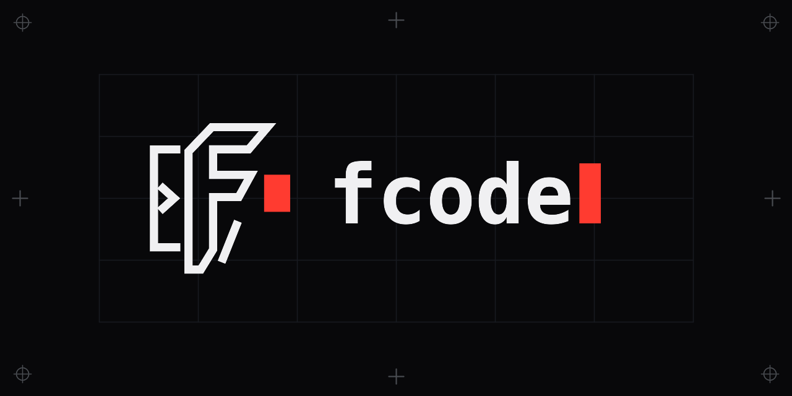
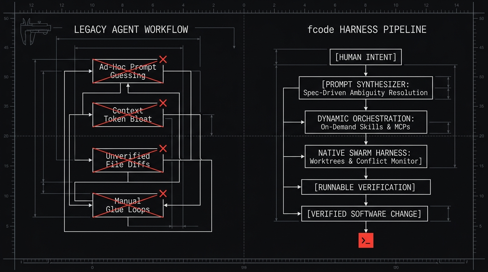
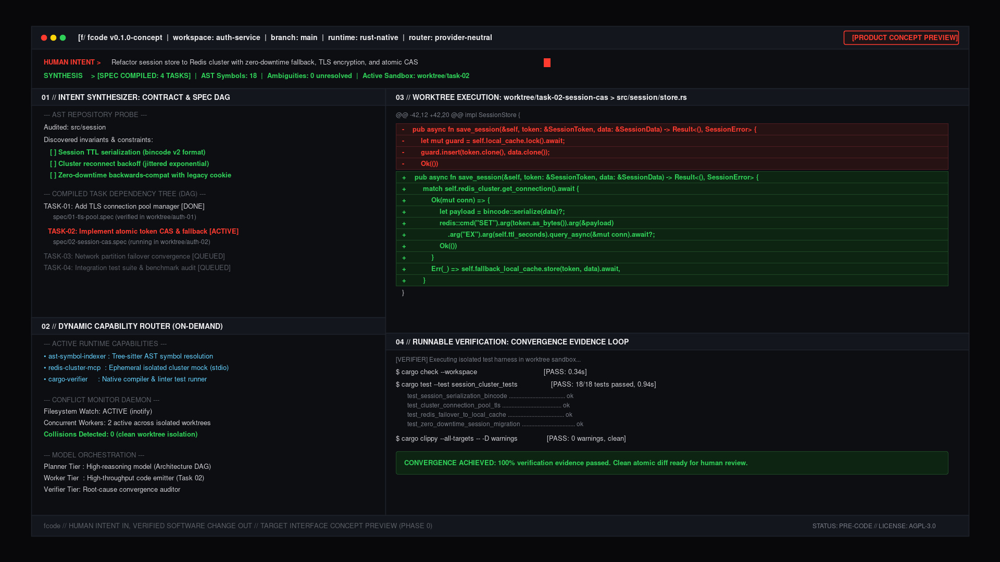

<div align="center">



# fcode

**An original software development harness.**  
*Human intent in, verified software change out.*

[](LICENSE)
[](docs/ROADMAP.md)

</div>

---

## What is fcode?

`fcode` is an autonomous software engineering harness built to eliminate the orchestration overhead in AI-assisted development.

Most coding agents operate as conversational chat bots. They expect engineers to write detailed prompts, diagnose confusing errors, audit raw code diffs by hand, and manually run test suites. When instructions are ambiguous, agents guess silently, produce broken edits, and leave the cleanup to the developer.

`fcode` changes this relationship. Instead of requiring the developer to coordinate models, context windows, tools, and testing loops, `fcode` takes high-level intent, clarifies ambiguities before touching code, coordinates specialized capabilities on demand, and verifies every edit with automated test suites before presenting the result for human review.

---

## The Problem: The Orchestration Tax

Using AI coding assistants today often feels like managing an eager junior engineer who needs constant supervision. Developers spend time on repetitive chores:

1. **Prompt babysitting:** Re-explaining codebase conventions, directory structures, and edge cases across every prompt.
2. **Context rot:** Loading dozens of tools, schemas, and file dumps into context until the model gets confused and forgets earlier constraints.
3. **Unverified changes:** Reviewing speculative diffs that compile in isolation but break integration tests or violate subtle invariants.
4. **Tool friction:** Switching between fragile chat interfaces, bloated desktop wrappers, and terminal windows.

The goal of `fcode` is to remove this manual coordination entirely: you provide the intent, and the harness delivers verified code.

---

## The Execution Model

Rather than making immediate edits based on conversational chat, `fcode` runs every task through a disciplined five-stage pipeline:

```
[HUMAN INTENT]
       |
       v
[PROMPT SYNTHESIZER]  --> Audits AST, discovers unstated assumptions, compiles spec
       |
       v
[DYNAMIC ORCHESTRATOR]--> Selects models and loads on-demand Skills and MCP tools
       |
       v
[NATIVE SWARM HARNESS]--> Runs workers in isolated git worktrees with conflict detection
       |
       v
[RUNNABLE VERIFICATION]-> Executes automated test suites, typechecks, and linters
       |
       v
[VERIFIED SOFTWARE CHANGE]
```

<div align="center">
  
</div>

### 1. Intent Synthesis
Before modifying any files, the Prompt Synthesizer inspects repository structure, symbol definitions, and active governance rules. It checks the request against codebase realities, detects missing requirements or ambiguities, and confirms assumptions with the developer when needed. It then compiles the intent into an executable task specification.

### 2. Capability Orchestration
Capabilities load strictly on demand. Instead of bloating every session with unused tool definitions, `fcode` indexes available Skills and Model Context Protocol (MCP) servers on disk and activates only the tools required for the task.

### 3. Isolated Swarm Execution
Work happens in ephemeral, isolated git worktrees. Multiple workers can explore solutions or edit independent modules simultaneously without touching the primary branch. A filesystem monitor tracks file edits to detect and prevent conflicts before they reach disk.

### 4. Automated Verification
No code change reaches the primary branch without runnable proof. The harness automatically runs repository test suites, typecheckers, and linters. If tests fail, error outputs feed directly back to the worker for root-cause repair.

### 5. Verified Review Package
Once verification passes, `fcode` presents a complete review package: an atomic diff, execution logs, and proof of passing verification tests.

---

## Interface Concept

`fcode` is designed terminal-native from day one: fast, keyboard-driven, and focused on code craft rather than marketing chrome.

<div align="center">
  
  <br />
  <sub><i>Concept preview of the fcode terminal interface in an active workspace. This illustrates target interface ergonomics, not shipped functionality.</i></sub>
</div>

---

## Mascot: syn (The Synthesis Sentinel)

<div align="center">
  
  <br />
  <sub><b>syn</b>: The Synthesis Sentinel</sub>
</div>

`syn` is the official fcode sentinel owl, constructed entirely from terminal character geometry:
* **Left Eye:** Input prompt bracket `[ >` signifying active intent ingestion.
* **Right Eye:** Block cursor `[ █ ]` in signal crimson representing live synthesis and code execution.
* **Beak:** Command chevron and slash separator.
* **Wings:** Terminal framing brackets `[` `]`.
* **Perch:** Dashed baseline terminal rule.

`syn` watches over repository invariants, monitors AST convergence during worker swarm operations, and guards code quality across test loops.

---

## Where the Project is Going

Development follows a structured roadmap toward an autonomous, native development harness:

* **Phase 0 (Foundation):** Core architecture specifications, agent governance, design foundation, and reproducible brand system. *(Current milestone)*
* **Phase 1 (Native Harness Core):** Native Rust core implementation (`src/`), universal streaming provider layer (Anthropic, OpenAI, Gemini, local models), primitive tool engine, and process execution sandboxes.
* **Phase 2 (Prompt Synthesizer and Capabilities):** Intent ingestion engine, specification compiler, on-demand skill loader, and MCP protocol integration.
* **Phase 3 (Concurrent Swarms and Verification):** Automated git worktree provisioning, filesystem conflict monitoring, and automated test convergence loops.
* **Phase 4 (Developer Preview):** Headless scripted CLI (`fcode exec`), review package generation, Starlight documentation portal, and cross-platform distribution.

For complete phase details, consult [`docs/ROADMAP.md`](docs/ROADMAP.md).

---

## Current Status

This repository is currently at **Phase 0 (Foundation)**:

* **Architecture thesis and decisions:** Documented in [`docs/ARCHITECTURE.md`](docs/ARCHITECTURE.md) and [`docs/DECISIONS_AND_NON_GOALS.md`](docs/DECISIONS_AND_NON_GOALS.md).
* **Agent governance rules:** Canonical instructions in [`AGENTS.md`](AGENTS.md) and path-scoped rules in [`.claude/rules/`](.claude/rules/).
* **Visual identity and brand assets:** Documented in [`DESIGN.md`](DESIGN.md) with canonical vectors and production assets in [`assets/brand/`](assets/brand/).
* **Tooling and verification:** Automated generation and verification suites in [`scripts/`](scripts/).

There are no install packages published yet, and no production CLI binaries available. The repository is undergoing human review before Phase 1 engine implementation begins.

---

## License

`fcode` is licensed under the **GNU Affero General Public License v3.0 or later** ([AGPL-3.0-or-later](LICENSE)).

See [`LICENSE`](LICENSE) for the full license text.
